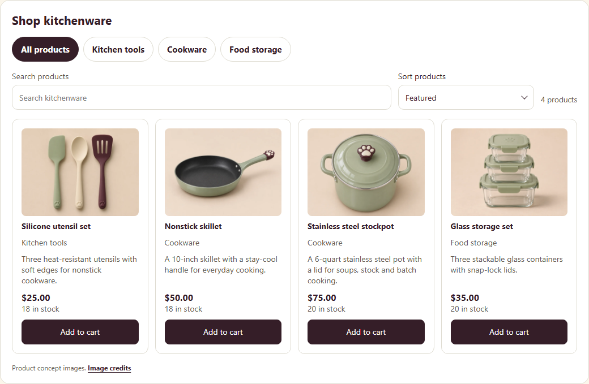

# E-Commerce Checkout Platform

A kitchenware shopping website built with React, TypeScript, and Spring Boot. Browse products, manage a cart, use coupons, and review orders. Payments, refunds, and shipping are simulated.

[Features](#features) · [Preview](#preview) · [Quick start](#quick-start)

## Features

- Search kitchenware, filter by category, sort by price, and view product specifications and care instructions.
- Manage a cart and check out selected items as a guest or signed-in customer.
- Sign in to claim and use coupons for discounts or gifts. Guest checkout is available without coupons.
- Filter and page through order history, and try simulated payments, refunds, and shipping.

## Preview

<table>
  <tr>
    <th>Product catalog</th>
    <th>Order history</th>
  </tr>
  <tr>
    <td></td>
    <td></td>
  </tr>
</table>

## Tech stack

| Layer | Technologies |
| --- | --- |
| Frontend | React 19, TypeScript, Vite |
| Backend | Java 21, Spring Boot, Spring Security, JDBC |
| Data and authentication | PostgreSQL, Keycloak / OpenID Connect |
| Testing and tooling | JUnit, Vitest, Playwright, JaCoCo, Docker Compose, GitHub Actions |

## Quick start

**Requirements:** Docker with Compose v2. The command below works in Bash and PowerShell; Java and Node.js run inside the build containers.

Clone the repository and enter its directory:

```sh
git clone https://github.com/mchen11077/ecommerce-checkout-platform.git
cd ecommerce-checkout-platform
```

Start the application:

```sh
docker compose --project-directory . -p ecommerce-demo --env-file deploy/rehearsal.env -f deploy/docker-compose.release.yml -f deploy/docker-compose.rehearsal.yml up -d --build postgres keycloak migrate app web seed
```

Open [localhost:5186](http://localhost:5186). Use `shopper-a` / `LocalShopperA-201!` to sign in to the local demo.

Try this workflow: add the **$50 skillet** and **$25 utensil set**, claim **Kitchen starter savings**, and apply it at checkout. The **$10 discount** brings the total to **$65**. Open **My orders** to review the receipt and try a refund or shipment.

<details>
<summary>Stop the demo</summary>

```sh
docker compose --project-directory . -p ecommerce-demo --env-file deploy/rehearsal.env -f deploy/docker-compose.release.yml -f deploy/docker-compose.rehearsal.yml stop
```

</details>

## Image credits

Product images are AI-generated concepts. See [image credits](frontend/public/photo-credits.html) for attribution and reference-photo licenses.
