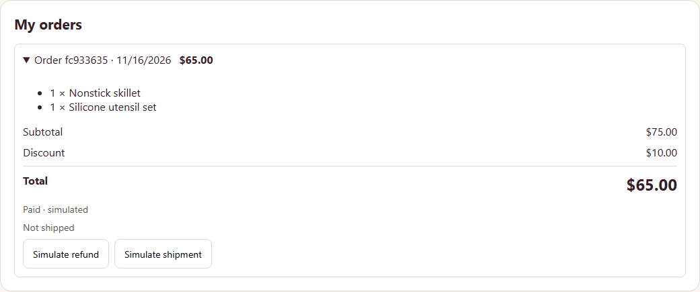

# E-Commerce Checkout Platform

A full-stack commerce demo focused on coupon eligibility, redemption, and transactional checkout. The kitchenware storefront provides a concrete workflow for browsing products, managing a cart, applying discounts, and reviewing orders. Payment, refunds, and shipping are simulated.

## Run the demo

Run this command from the repository root with Docker Compose v2. It works in Bash and PowerShell.

```sh
docker compose --project-directory . -p ecommerce-demo --env-file deploy/rehearsal.env -f deploy/docker-compose.release.yml -f deploy/docker-compose.rehearsal.yml up -d --build postgres keycloak migrate app web seed
```

Open [localhost:5186](http://localhost:5186). The local-only demo account is `shopper-a` with password `LocalShopperA-201!`.

Add the $50 skillet and $25 utensil set, claim **Kitchen starter savings**, and apply it at checkout. The $10 discount brings the total to **$65**. The receipt appears under **My orders**.

Stop the demo with the same Compose options, replacing `up -d --build postgres keycloak migrate app web seed` with `stop`.

<details>
<summary>Demo screenshots</summary>




</details>

## Architecture

The React and TypeScript storefront talks to the Java 21 Spring Boot API through Nginx. Keycloak provides OpenID Connect sessions. PostgreSQL stores stock, orders, and each customer's coupon claim. Claiming a coupon reserves it for the customer. Redemption consumes one use when checkout succeeds.

| Checkout case | Implementation |
| --- | --- |
| Retry after a lost response | The browser persists the order ID and selected items for a retry after same-tab refresh. PostgreSQL enforces a unique `(user_id, order_id)` key. Replaying the same request returns its original receipt. |
| A cart item is out of stock | Inventory uses a conditional update with `available >= quantity`. A rejected line rolls back the order and earlier inventory updates in the same transaction. |
| Refund and shipment arrive together | Both operations lock the order with `SELECT ... FOR UPDATE`. The first valid transition wins. A refund restores inventory once. |

## Coupon claim experiments

These results are from a separate local Docker/k6 benchmark. The synchronous claim test used 1,600 virtual users, 2 vCPUs per application replica, and disabled the Kafka consumer to isolate the API path.

| Application replicas | Claims per second | p95 | p99 |
| ---: | ---: | ---: | ---: |
| 1 | 7,095 | 292.1 ms | 356.6 ms |
| 3 | 19,712 | 164.4 ms | 215.1 ms |

The browser acceptance test checks two concurrent claims against one available coupon and expects one success and zero excess claims.

In a separate Kafka test with the same coupon ID key, batching database writes reduced consumer catch-up time from **86.7 s to 18.2 s**. See the [benchmark setup and results](perf/README.md) and [claim implementations](docs/claim-experiments.md).

## Repository layout

| Directory | Contents |
| --- | --- |
| [app](app) | Spring Boot API, checkout transactions, and PostgreSQL integration tests |
| [coupon-web](coupon-web) | React storefront and component tests |
| [coupon-client](coupon-client) | TypeScript client for coupon operations |
| [deploy](deploy) | Storefront Compose files, Keycloak fixture, and SQL migrations |
| [e2e](e2e) | Playwright storefront tests |
| [perf](perf) | k6 workloads and benchmark scripts |
| [scripts](scripts) | Local verification and experiment commands |
| [docs](docs) | Claim experiments and supporting notes |

The root [docker-compose.yml](docker-compose.yml) runs the coupon API with PostgreSQL, Redis, and Kafka. The Compose files in [deploy](deploy) run the browser storefront with Keycloak and PostgreSQL.

## Tests

[GitHub Actions](.github/workflows/coupon.yml) runs JUnit, Vitest, checkout API checks, and a Chromium release rehearsal. The Java job uploads the JaCoCo report.

- Run Java tests with `mvn -f app/pom.xml test`. Enable the [PostgreSQL checkout tests](app/src/test/java/com/coursework/coupon/CheckoutPostgresTest.java) with `CHECKOUT_TEST_JDBC_URL`, `CHECKOUT_TEST_DB_USER`, and `CHECKOUT_TEST_DB_PASSWORD`.
- Use Node.js 22 for the [frontend tests and build](coupon-web/README.md).
- See the [release guide](deploy/README.md) for the local browser rehearsal command.

## Image credits

The catalog uses generated product concepts. See [image credits and reference-photo licenses](coupon-web/public/photo-credits.html).
