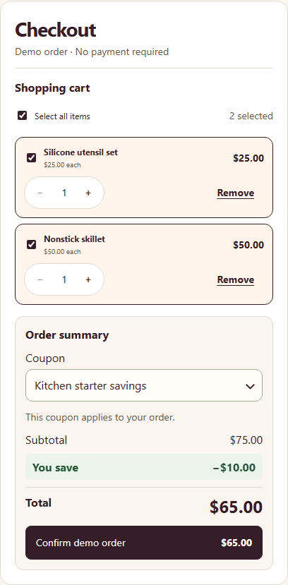

# E-Commerce Checkout Platform

A kitchenware storefront built with React, TypeScript, Java 21, and Spring Boot. It supports product browsing, cart checkout, coupon claiming and redemption, and order history. Payments, refunds, and shipping are simulated.



## Core features

- **Cart and coupons:** select items, adjust quantities, claim discounts or gifts, and check eligibility against the selected cart.
- **Retry-safe checkout:** the browser preserves the order request across a same-tab refresh. A unique `(user_id, order_id)` constraint lets the API return the original receipt without deducting inventory twice.
- **Transactional inventory:** conditional stock updates and order creation share a PostgreSQL transaction. An unavailable item rolls back earlier deductions.
- **Order lifecycle:** refunds and shipments lock the order before changing its state. A successful refund restores inventory once.
- **Authentication:** Keycloak provides OpenID Connect sign-in; the API enforces account ownership and CSRF protection.

Nginx serves the storefront and proxies the API. PostgreSQL stores orders, inventory, and coupon claims. A separate Redis/Kafka claim implementation supports the [performance experiments](perf/README.md).

## Run the demo

Install Docker with Compose v2, then run from the repository root:

```sh
docker compose --project-directory . -p ecommerce-demo --env-file deploy/rehearsal.env -f deploy/docker-compose.release.yml -f deploy/docker-compose.rehearsal.yml up -d --build postgres keycloak migrate app web seed
```

Open [localhost:5186](http://localhost:5186). Sign in with the local demo account `shopper-a` / `LocalShopperA-201!`.

Add the $50 skillet and $25 utensil set, claim **Kitchen starter savings**, and apply it at checkout. The total is **$65** after the $10 discount. Review the receipt in **My orders**, then try a simulated refund or shipment.

To stop the demo:

```sh
docker compose --project-directory . -p ecommerce-demo --env-file deploy/rehearsal.env -f deploy/docker-compose.release.yml -f deploy/docker-compose.rehearsal.yml stop
```

## Tests and performance

[GitHub Actions](.github/workflows/coupon.yml) runs JUnit, Vitest, PostgreSQL integration checks, and Playwright tests in Chromium and WebKit. The backend job publishes JaCoCo coverage. See the [QA report](docs/QA_REPORT.md) and [feature matrix](docs/FEATURE_MATRIX.md) for verified behaviors, coverage, and remaining gaps.

In a local Docker/k6 experiment, increasing the synchronous claim service from one to three replicas raised throughput from 7,095 to 19,712 claims/s. This measured the claim API with the Kafka consumer disabled, not end-to-end storefront capacity. Environment, latency measurements, and consumer batching results are documented in the [benchmark report](perf/README.md).

## Development

- [Storefront setup and component tests](coupon-web/README.md)
- [TypeScript coupon client](coupon-client/README.md)
- [Deployment configuration and release rehearsal](deploy/README.md)
- [Coupon claim implementations](docs/claim-experiments.md)

## Image credits

Product images are AI-generated concepts. Attribution and reference-photo licenses are listed in [image credits](coupon-web/public/photo-credits.html).
